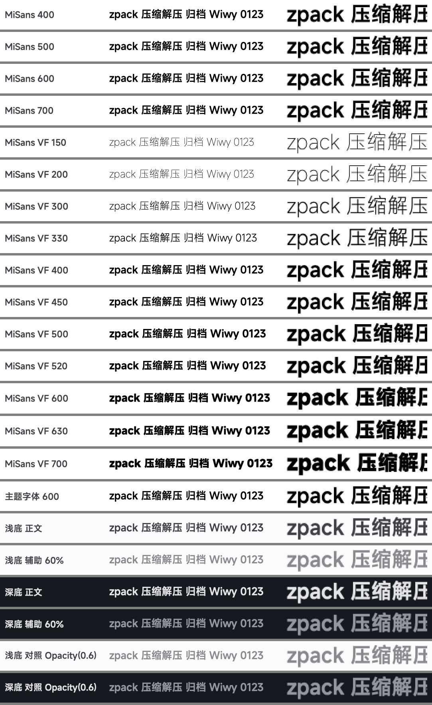
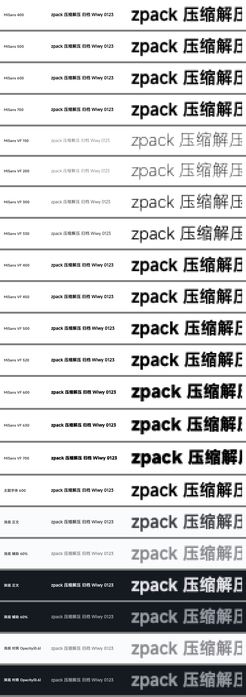

# 字体渲染对照表：macOS 实测 / Windows 待测

同一组文字样本、同一个探针，在两个平台上各跑一遍，逐项对照。
**macOS 一列已填（2026-11-23）；Windows 一列留空，在 Windows 机上跑完探针后回填。**

- 测试串：`zpack 压缩解压 归档 Wiwy 0123`（拉丁 + 中文 + 数字），字号 13 DIP（界面正文字号）
- 探针：`fontprobe_test.go`（无头 Tester，默认跳过）
- 缩放：`1x` = 100% DPI；`2x` = 200% DPI，**Windows 实机条件，以 2x 为准**
- 环境：macOS 27.0.1 (26A434) / arm64 / mygo v0.10.0

---

## 1. 在 Windows 上跑出同口径的数

Git Bash（该机 Go 不在 PATH）：

```bash
cd ui/gui
export PATH="/c/Program Files/Go/bin:$PATH"
ZPACK_GUI_FONT_PROBE=1 go test -run TestFontProbe -count=1 -v .
```

PowerShell：

```powershell
cd ui/gui
$env:ZPACK_GUI_FONT_PROBE = "1"
go test -run TestFontProbe -count=1 -v .
```

产物在 `ui/gui/build/fontprobe/`（已被 gitignore）：

| 文件 | 内容 |
|---|---|
| `fontprobe-windows-amd64.txt` | 全部样本的量测日志，每行一个样本 |
| `fontprobe-windows-amd64-1x.png` | 100% DPI 参考图 |
| `fontprobe-windows-amd64-2x.png` | 200% DPI 参考图 |

每行日志的格式：

```
FONT-PROBE|scale=2|颜色|深底 辅助 60%|bg=#151a21|text=#ebebf5@60%|ink=484.36|fringeMax=0|fringeMean=0.0|extreme=#9597a0|contrast=6.00|bbox=386x29
```

- [ ] Windows 环境记录：系统版本 ______　DPI 缩放 ______%　ClearType 开 / 关　外观 浅色 / 深色

---

## 2. 指标含义

| 指标 | 含义 | 怎么看 |
|---|---|---|
| **墨水**（ink） | 有墨像素偏离底色的程度之和，已归一到 100% DPI | 只比**相对关系**（谁与谁相同、阶梯是否递增）。绝对值受抗锯齿方式影响，跨平台会有几个百分点差异 |
| **彩边**（fringeMax） | 边缘像素三通道极差超出文字/底色自身通道差的最大值（0–255） | 灰度抗锯齿恒为 0。明显大于 0 = 亚像素（ClearType）在起作用 |
| **核心色**（extreme） | 笔画核心像素的众数 | 实色文字 = 文字色本身；半透明文字 = 与底色的合成色 |
| **对比度**（contrast） | 核心色对底色的 WCAG 对比度 | WCAG AA 要求正文 ≥ 4.5，AAA 要求 ≥ 7。浅色辅助色 3.40 低于 AA |

细笔画样本（VF 150–330 在 1x 下）没有满覆盖像素，其核心色 / 对比度无意义，字重表只看墨水与彩边。

---

## 3. 表一：字重阶梯

13px，黑字白底。每格 = **墨水 / 彩边**。

| 样本 | macOS 1x | macOS 2x | Windows 1x | Windows 2x |
|---|---|---|---|---|
| MiSans 400 | 881.47 / 0 | 869.50 / 0 | | |
| MiSans 500 | 881.47 / 0 | 869.50 / 0 | | |
| MiSans 600 | 881.47 / 0 | 869.50 / 0 | | |
| MiSans 700 | 881.47 / 0 | 869.50 / 0 | | |
| MiSans VF 150 | 263.60 / 0 | 265.35 / 0 | | |
| MiSans VF 200 | 263.60 / 0 | 265.35 / 0 | | |
| MiSans VF 300 | 384.75 / 0 | 387.10 / 0 | | |
| MiSans VF 330 | 501.88 / 0 | 505.46 / 0 | | |
| MiSans VF 400 | 881.60 / 0 | 869.51 / 0 | | |
| MiSans VF 450 | 881.60 / 0 | 869.51 / 0 | | |
| MiSans VF 500 | 983.51 / 0 | 974.48 / 0 | | |
| MiSans VF 520 | 983.51 / 0 | 974.48 / 0 | | |
| MiSans VF 600 | 1140.43 / 0 | 1137.26 / 0 | | |
| MiSans VF 630 | 1140.43 / 0 | 1137.26 / 0 | | |
| MiSans VF 700 | 1227.24 / 0 | 1239.50 / 0 | | |
| 主题字体 600 | 881.47 / 0 | 869.50 / 0 | | |

**macOS 读数**

- `MiSans` 是单面静态族：请求 400 / 500 / 600 / 700 渲染完全相同。最后一行「主题字体 600」是 mygo 内置控件（如 Toast 标题）对主题字体提字重的处境，结果同样相同。
- `MiSans VF` 按字重最近邻落到命名实例：150 与 200 同面，400 与 450 同面，500 与 520 同面，600 与 630 同面。
- 彩边全为 0：macOS 引擎恒为灰度抗锯齿。

**Windows 预期（源码推断，未实测）**

- `MiSans` 四行与「主题字体 600」应彼此相同（dwrite 只会返回这唯一的面）。
- `MiSans VF` 按命名实例最近邻落点：150 / 200 / 450 / 520 / 630 / 700 应各自成一档；300、330、400、500、600 落在哪一档待测。
- 若系统开着 ClearType，彩边应明显大于 0；关掉 ClearType 重跑应回到 0。

---

## 4. 表二：文字色 Token

13px，主题字体。

### macOS 实测

| 样本（括号内为文字色 Token） | 核心色 | 对比度 | 墨水 1x | 墨水 2x | 彩边 1x / 2x |
|---|---|---|---|---|---|
| 浅底 正文（`#3f3f46`） | `#3f3f46` | 10.08 | 643.16 | 634.39 | 0 / 0 |
| 浅底 辅助 60%（`#3c3c43@60%`） | `#88888d` | 3.40 | 393.18 | 388.18 | 0 / 0 |
| 深底 正文（`#e4e4e7`） | `#e4e4e7` | 13.77 | 804.84 | 773.59 | 0 / 0 |
| 深底 辅助 60%（`#ebebf5@60%`） | `#9597a0` | 6.00 | 503.95 | 484.36 | 0 / 0 |

样本名与探针日志的样本名一字不差，回填时按名取行即可。

### Windows 实测（待填）

| 样本（括号内为文字色 Token） | 核心色 | 对比度 | 墨水 1x | 墨水 2x | 彩边 1x / 2x |
|---|---|---|---|---|---|
| 浅底 正文（`#3f3f46`） | | | | | |
| 浅底 辅助 60%（`#3c3c43@60%`） | | | | | |
| 深底 正文（`#e4e4e7`） | | | | | |
| 深底 辅助 60%（`#ebebf5@60%`） | | | | | |

- [ ] Windows 核心色 / 对比度与 macOS 是否一致：______
- [ ] Windows 彩边读数：______　关 ClearType 后重跑：______

---

## 5. 表三：文字色 alpha 是否等价于元素 Opacity

辅助行的文字色自带 60% alpha；对照行用实色文字 + 元素 `.Opacity(0.6)`。两项相同，说明「半透明」不管写在颜色里还是写在元素上，渲染结果一样。

### macOS 实测

| 底色 | 缩放 | 辅助 60%：墨水 / 核心色 | 对照 Opacity(0.6)：墨水 / 核心色 | 是否一致 |
|---|---|---|---|---|
| 浅底 | 1x | 393.18 / `#88888d` | 393.18 / `#88888d` | 是 |
| 浅底 | 2x | 388.18 / `#88888d` | 388.18 / `#88888d` | 是 |
| 深底 | 1x | 503.95 / `#9597a0` | 503.95 / `#9597a0` | 是 |
| 深底 | 2x | 484.36 / `#9597a0` | 484.36 / `#9597a0` | 是 |

### Windows 实测（待填）

| 底色 | 缩放 | 辅助 60%：墨水 / 核心色 | 对照 Opacity(0.6)：墨水 / 核心色 | 是否一致 |
|---|---|---|---|---|
| 浅底 | 1x | | | |
| 浅底 | 2x | | | |
| 深底 | 1x | | | |
| 深底 | 2x | | | |

---

## 6. 参考图

每行三列：行说明 / 原生像素 / 放大镜。行序与表一、表二一致。
**看原生像素列时把图片查看器缩放设为 100%**，否则查看器自己的缩放会糊掉字。

### macOS

200% DPI（实机条件）：



100% DPI：



### Windows（待贴）

- [ ] 把 `ui/gui/build/fontprobe/fontprobe-windows-amd64-2x.png` 和 `-1x.png` 拷到 `ui/gui/fontprobe/`，再去掉下面两行的注释。

<!--  -->

<!--  -->

---

## 7. Windows 实机目测待办

探针是无头渲染，以下几项只能在真实窗口里看。

- [ ] **实验一（彩边）**：运行 `cttune`，取消勾选「启用 ClearType」，完成后重启 zpack。
  - [ ] 字是否变干净：______
  - [ ] 重跑探针后彩边读数：______
- [ ] **实验二（缩放）**：侧栏图标和 1px 分隔线是否也发糊？
  - [ ] ______（只有字糊 = 字体渲染问题；图标也糊 = 窗口被系统按 DPI 缩放）
- [ ] **实验三（对比度）**：只有解释行发虚，还是正文也发虚？
  - [ ] ______（只有解释行 = 辅助色 60% alpha 的对比度问题）
- [ ] 深色 / 浅色外观下观感是否有差别：______
- [ ] Toast 的标题和动作按钮是否比正文粗（内置控件请求 600 字重，macOS 上不粗）：______

---

## 8. 结论回填

- Windows 发虚的主因：______
- 与 macOS 的差异点：______
- 需要改的地方：______

---

## 附：已核对的 mygo v0.10.0 源码事实

Windows 侧只有源码推断，没有实测；上面的表就是为了验证这些推断。

- **亚像素的开关与文字透明度无关。** 是否走 ClearType 在 `ui/paint.go:1061` 由 `p.opaque && !moves` 决定。`p.opaque` 的含义是「字下方有没有已画好的不透明背景」。文字色带 alpha、元素 `.Opacity()` 都不参与判定，alpha 在 1065 行事后乘进颜色。
- **只有 Windows 引擎走亚像素。** macOS 引擎恒为灰度。`SetFontRendering` 只对 Linux 生效，Windows 上没有应用级灰度开关，只能改系统 ClearType 设置。
- **`ui.Color.Alpha(a)` 是相乘。** mygo 默认主题的 `TextMuted` 是实色，框架内部与 `main.go` 多处用 `TextMuted.Alpha(x)` 派生背景。把 `TextMuted` 设成 60% alpha 后，这些派生色缩水到原来的 60%。
- **单面静态族不会合成加粗。** macOS 在该族已注册的面里取字重最近者；dwrite 用 `GetFirstMatchingFont(weight)`，同样只有这一个面。dwrite 引擎没有可变字体轴代码，VF 的字重靠命名实例。
